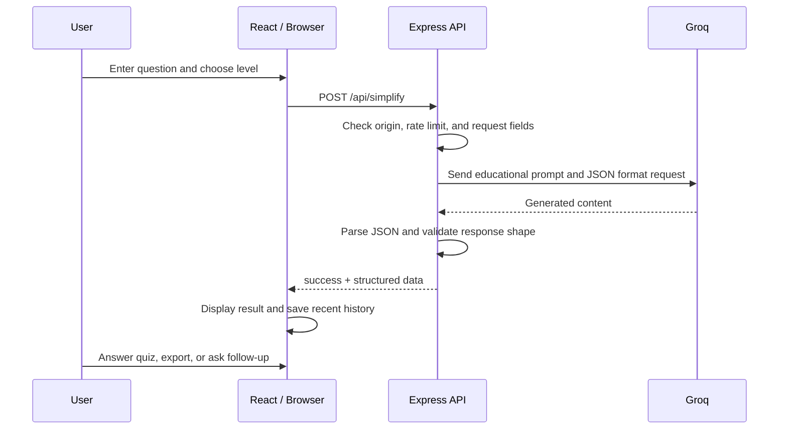

# ELI5 Simplifier

ELI5 Simplifier is an AI learning companion that turns a topic or question into an explanation suited to the reader. Choose **ELI5**, **Teen**, or **Expert** to receive a main explanation, a real-world example, three to five key takeaways, and a three-question quiz.

The application combines a React interface with an Express API. The API sends educational prompts to Groq, validates the generated JSON, and returns a consistent response for the interface to display. Recent successful results stay in the browser, so there is no database or account setup.

This README documents the implementation in this repository, including setup, request handling, data storage, AI generation, deployment, and current limitations.

## Contents

- [What the application does](#what-the-application-does)
- [Explanation levels](#explanation-levels)
- [Technology stack](#technology-stack)
- [Architecture and request flow](#architecture-and-request-flow)
- [Repository structure](#repository-structure)
- [Prerequisites](#prerequisites)
- [Local setup](#local-setup)
- [Environment configuration](#environment-configuration)
- [Using the application](#using-the-application)
- [API reference](#api-reference)
- [AI generation and response validation](#ai-generation-and-response-validation)
- [Frontend state and browser storage](#frontend-state-and-browser-storage)
- [Interface and accessibility](#interface-and-accessibility)
- [Security and operational behavior](#security-and-operational-behavior)
- [Commands and verification](#commands-and-verification)
- [Production deployment](#production-deployment)
- [Troubleshooting](#troubleshooting)
- [Extending the project](#extending-the-project)
- [Known limitations](#known-limitations)
- [License](#license)

## What the application does

| Capability | Current behavior |
| --- | --- |
| Audience selection | Generates one explanation for `eli5`, `teen`, or `expert` per request. |
| Educational response | Includes an explanation, a separate example, key takeaways, and a quiz. |
| Markdown display | Renders the explanation and example with `react-markdown`. |
| Knowledge check | Provides three questions with four options each, answer feedback, explanations, a score, and retry. |
| Follow-up questions | Sends the current topic and explanation as context for a new question. |
| Recent history | Keeps up to 20 successful results in browser `localStorage`. |
| Copy | Copies the explanation, example, and key takeaways to the clipboard. |
| Listen | Reads the explanation and example using browser speech synthesis. |
| Export | Downloads the explanation, example, and takeaways as a Markdown file. |
| Regenerate | Sends the current query and selected level again to generate a fresh result. |
| Suggested topics | Offers topic shortcuts and learning sections to help start a question. |
| Request feedback | Shows loading animation, errors, and retry controls. |

The quiz is interactive within the browser. Answers and scores are not submitted to the backend or saved as learning progress.

## Explanation levels

The selected level changes the instructions sent to the model. It is a choice of writing depth, not an account setting or age-verification mechanism.

| Level | API value | Generation guidance |
| --- | --- | --- |
| ELI5 | `eli5` | Very simple vocabulary, short sentences, and everyday analogies for a curious five-year-old. |
| Teen | `teen` | Conversational explanations, relatable examples, and definitions for necessary terminology. |
| Expert | `expert` | Precise technical language, mechanisms, assumptions, and relevant nuance. |

The API defaults to `eli5` when `level` is omitted. Values are case-sensitive: use `teen`, not `Teen`.

Only the selected level is generated. Changing the selector alone does not request another explanation; submit or regenerate to obtain content at the new level.

## Technology stack

### Frontend

- **React and React DOM:** component rendering, state, effects, and event handling.
- **Vite:** local development server and production bundling.
- **Tailwind CSS:** utility styling through the Tailwind Vite plugin.
- **Framer Motion:** animated interface transitions.
- **Lucide React:** icons.
- **React Markdown:** rendering generated Markdown in result cards.
- **Browser APIs:** `fetch`, `localStorage`, Clipboard, Speech Synthesis, Blob downloads, and canvas animation.

### Backend

- **Node.js:** runtime and built-in test runner.
- **Express:** routing, JSON body parsing, and middleware.
- **Groq SDK:** chat completion requests.
- **dotenv:** loading server environment variables from `.env`.
- **cors:** browser origin policy.

The client uses ES modules; the server uses CommonJS. Axios is listed in both packages, but the current browser request flow uses native `fetch`, and the AI service uses the Groq SDK.

There is no MongoDB or Mongoose integration. The `server/models/` directory currently has no implemented database models.

## Architecture and request flow



1. `App.jsx` owns the query, selected level, loading state, result, errors, and history.
2. `HeroSection.jsx` collects input and triggers a request.
3. The browser posts JSON to the configured API base plus `/simplify`, with a 45-second browser timeout.
4. During local development, Vite forwards `/api` requests to `http://localhost:5000`.
5. Express applies CORS, parses JSON, and applies the per-IP request limit.
6. `simplifyRoutes.js` routes the request to `simplifyController.js`.
7. The controller checks input and optional follow-up context, then calls `groqService.js`.
8. The service creates the audience-specific prompt, requests a Groq completion, parses it, and validates required fields.
9. The browser displays successful data and adds query metadata before saving history.
10. `ResultsSection.jsx` manages quiz interaction and result actions locally.

The backend does not keep conversational sessions. A follow-up works because the browser explicitly includes the current explanation in that request.

## Repository structure

```text
eli5-simplifier/
├── README.md
├── .gitignore
├── client/
│   ├── package.json
│   ├── package-lock.json
│   ├── vite.config.js             # React/Tailwind plugins and development proxy
│   ├── eslint.config.js           # JavaScript, React Hooks, and refresh rules
│   ├── index.html
│   ├── public/                    # Static icons and favicon
│   └── src/
│       ├── main.jsx               # React entry point
│       ├── App.jsx                # Requests, result state, history, and follow-ups
│       ├── App.css
│       ├── index.css
│       ├── assets/
│       ├── lib/
│       │   └── utils.js           # Clipboard, export, speech, and time utilities
│       └── components/
│           ├── Navbar.jsx
│           ├── HeroIntro.jsx
│           ├── HeroSection.jsx    # Question input and audience selection
│           ├── LearningSections.jsx
│           ├── ResultsSection.jsx # Explanation, quiz, and follow-up form
│           ├── HistoryDrawer.jsx
│           ├── Toast.jsx
│           ├── AmbientBackground.jsx
│           ├── DotField.jsx
│           ├── liquid-navbar/
│           └── thinking-input/    # Input animation and canvas orb renderer
└── server/
    ├── package.json
    ├── package-lock.json
    ├── .env                       # Local configuration; ignored by Git
    ├── server.js                  # App creation, CORS, rate limit, and listener
    ├── controllers/
    │   └── simplifyController.js  # Request validation and success response
    ├── routes/
    │   └── simplifyRoutes.js
    ├── services/
    │   └── groqService.js         # Prompt, provider call, parsing, and validation
    ├── middleware/
    │   └── errorHandler.js        # JSON error responses
    ├── models/                    # Currently unused
    └── test/
        └── server.test.js
```

`node_modules/` and the generated client `dist/` directory are installation/build artifacts and are omitted above.

## Prerequisites

- **Node.js compatible with the installed Vite version.** The installed Vite package declares `^20.19.0 || >=22.12.0`; Node.js 22.12 or later is a suitable baseline for this checkout. Node.js 18 is insufficient for that frontend toolchain.
- **npm** to install dependencies and run package scripts.
- **A Groq API key** with access to the model configured in `server/services/groqService.js`.
- **Network access from the server to Groq** for real generation requests.
- **A modern browser** for the interface and its browser APIs.

Check your local tools:

```bash
node --version
npm --version
```

The client and server have separate dependency installations. There is no root `package.json` or root command that starts both applications.

## Local setup

Run these commands from the repository directory containing `client/`, `server/`, and this README.

### 1. Install dependencies

```bash
cd server
npm ci
cd ../client
npm ci
cd ..
```

`npm ci` uses each package's committed lockfile and requires it to agree with `package.json`. When deliberately changing dependencies, use `npm install` in the relevant package and review both the manifest and lockfile changes.

### 2. Configure the server

Create `server/.env` using your editor:

```dotenv
GROQ_API_KEY=replace_with_your_groq_api_key
PORT=5000
```

Replace the placeholder with your actual credential. Keep the key on the server. The repository ignores files named `.env`.

### 3. Start the backend

In one terminal, from the repository directory:

```bash
cd server
npm start
```

Expected startup output includes:

```text
App is listening on port 5000
```

### 4. Start the frontend

In a second terminal, from the repository directory:

```bash
cd client
npm run dev
```

Open the address printed by Vite, normally `http://localhost:5173`.

No client environment file is needed for this default setup. The client uses `/api` as its API base, and the development server proxies that path to the backend.

### 5. Check connectivity

```bash
curl http://localhost:5000/
```

Expected response:

```json
{"status":"ok"}
```

Then submit a topic through the browser or use the API examples below. The health endpoint only checks that Express responds; it does not check the API key, model access, quota, or Groq connectivity.

## Environment configuration

### Server variables

These belong in the backend process environment or `server/.env`.

| Variable | Required | Default | Purpose |
| --- | --- | --- | --- |
| `GROQ_API_KEY` | For AI generation | None | Authenticates the backend with Groq. |
| `PORT` | No | `5000` | Listening port, evaluated as `Number(process.env.PORT) || 5000`. |
| `CLIENT_URL` | For browser origins in production | No configured origins | Comma-separated list of allowed frontend origins. |
| `NODE_ENV` | Set for production | Unset | The exact value `production` disables automatic local-origin allowances. |

Example production configuration:

```dotenv
GROQ_API_KEY=replace_with_your_groq_api_key
PORT=5000
NODE_ENV=production
CLIENT_URL=https://learn.example.com,https://www.learn.example.com
```

CORS comparisons use exact origin strings. Use scheme, hostname, and port where applicable, with no URL path or trailing slash. Spaces around comma-separated entries are trimmed.

`dotenv` is initialized at server startup. Start the process from `server/` when relying on `server/.env`; running `node server/server.js` from another working directory does not make dotenv automatically locate that file. Hosting platforms can inject the variables directly instead.

### Client variable

| Variable | Required | Default | Purpose |
| --- | --- | --- | --- |
| `VITE_API_URL` | Only when the API needs a different base | `/api` | Base URL to which the client appends `/simplify`. |

For a separately hosted backend, create `client/.env` for local configuration or set the value in the frontend build environment:

```dotenv
VITE_API_URL=https://api.example.com/api
```

**Include `/api` in this value.** The resulting request must be `https://api.example.com/api/simplify`. Setting only `https://api.example.com` makes the browser request `/simplify`, which the backend does not implement. Avoid a trailing slash because the client appends a slash itself.

Vite embeds `VITE_*` values in the browser bundle at build time. Restart the development server after changing them; rebuild and redeploy production assets after changing the production value. Never put a Groq key in a `VITE_*` variable.

### Local port relationship

The backend defaults to port `5000`, and `client/vite.config.js` has a proxy target fixed at `http://localhost:5000`. If you change the backend port, update the proxy target or explicitly configure the client API base.

Vite is configured to prefer port `5173`. If it chooses a different port because that port is occupied, account for the actual frontend origin in the backend CORS configuration.

## Using the application

### Generate an explanation

1. Enter a topic or question, up to 5,000 characters.
2. Choose ELI5, Teen, or Expert.
3. Click **Explain** or press **Enter** in the main question field.
4. Use **Shift+Enter** to insert a newline instead of submitting.
5. Read the explanation, example, and takeaways after generation completes.

Suggested topic chips can submit a predefined question immediately. Learning-section choices can prepare a topic and level in the question editor.

Outside an input or textarea, `/` or **Command+K** focuses the main question field. The current implementation checks the Meta key; it does not add a separate Ctrl+K shortcut.

### Take the quiz

For each question, select an option and click **Check answer**. Once checked, that question's options are locked, the correct answer is highlighted, and an explanation appears. After checking all three questions, click **See score**.

**Retry quiz** clears local selections, feedback, and the displayed score. Loading another result resets the quiz for that result. Reloading a saved history entry restores content, not previous quiz answers.

### Ask a follow-up

The follow-up field accepts up to 2,000 characters in the interface. A follow-up request uses the current result's level and includes its topic and explanation. The client also sends the example, but the current AI prompt only uses the topic and explanation.

A successful follow-up replaces the current result and becomes a new history entry. It generates the full response structure, including a new example, takeaways, and quiz. Earlier turns are not automatically included.

The generic **Retry** and **Regenerate** actions call the ordinary generation path using the current query and selected level. They do not reconstruct the previous follow-up context, so regenerating a follow-up can produce an answer without its earlier explanation.

### Copy, listen, export, and history

- **Copy** includes the explanation, example, and key takeaways. It excludes quiz questions and answers.
- **Listen** reads the explanation and example. Clicking **Stop** cancels speech. Support and available voices depend on the browser and device.
- **Export** downloads a `.md` file containing the query, selected level, explanation, example, takeaways, and an export timestamp. It excludes the quiz.
- **Recent Queries** opens saved results. Selecting an entry restores it without making an API request. Each entry also has an export action.
- **Clear** in the history drawer removes all locally saved history for that origin.
- **New topic** returns to the input workflow; it does not clear saved history.

## API reference

### Base paths

| Environment | API endpoint |
| --- | --- |
| Default local backend | `http://localhost:5000/api/simplify` |
| Default browser development request | `/api/simplify`, forwarded by Vite |
| Separate production backend | `<backend-origin>/api/simplify` |

### `GET /` — health check

Returns HTTP `200`:

```json
{
  "status": "ok"
}
```

This is a process health check, not an AI readiness check.

### `POST /api/simplify` — explanation or follow-up

Send `Content-Type: application/json`.

#### Request fields

| Field | Type | Required | Rules |
| --- | --- | --- | --- |
| `text` | String | Yes | Must contain non-whitespace text; at most 5,000 characters before trimming. |
| `level` | String | No | `eli5`, `teen`, or `expert`; defaults to `eli5` when omitted. |
| `context` | Object | No | When supplied, must contain a string `topic` and non-empty string `explanation`. |
| `context.topic` | String | With context | Must be a string; current validation allows an empty string. |
| `context.explanation` | String | With context | Must contain non-whitespace text. |

The controller trims `text` before generation. The 5,000-character API limit applies to follow-up text too; the browser follow-up form applies its narrower 2,000-character limit.

There is no explicit field-length limit on context in the controller. The request body is still subject to Express JSON parser limits.

#### Ordinary request

```bash
curl -X POST http://localhost:5000/api/simplify \
  -H 'Content-Type: application/json' \
  -d '{"text":"How do APIs work?","level":"teen"}'
```

#### Follow-up request

```bash
curl -X POST http://localhost:5000/api/simplify \
  -H 'Content-Type: application/json' \
  -d '{
    "text": "Can you explain what a response contains?",
    "level": "teen",
    "context": {
      "topic": "APIs",
      "explanation": "An API lets programs communicate by sending requests and receiving responses."
    }
  }'
```

#### Successful response

The following illustrative response shows the complete expected shape. Generated wording varies.

```json
{
  "success": true,
  "data": {
    "topic": "How APIs Work",
    "level": "teen",
    "explanation": "An **API** is a set of rules that lets one program ask another program for information or an action. The caller sends a request, and the other program returns a response.",
    "example": "A weather app requests a forecast from a weather service API, then displays the response on your screen.",
    "keyTakeaways": [
      "APIs let programs communicate using agreed rules.",
      "A request asks for information or an action.",
      "A response carries the result back to the caller."
    ],
    "quiz": [
      {
        "question": "What does an API help programs do?",
        "options": ["Communicate", "Charge a battery", "Print every file", "Change screen size"],
        "correctAnswer": 0,
        "explanation": "An API provides agreed rules for communication between programs."
      },
      {
        "question": "What does the caller send to ask for information?",
        "options": ["A forecast", "A request", "A battery", "A screen"],
        "correctAnswer": 1,
        "explanation": "The caller sends a request to the other program."
      },
      {
        "question": "What carries the result back to the caller?",
        "options": ["An icon", "A keyboard", "A response", "A charger"],
        "correctAnswer": 2,
        "explanation": "The other program returns the result in a response."
      }
    ]
  }
}
```

#### Response guarantees after validation

- `topic`, `explanation`, and `example` are non-empty strings and are trimmed.
- `level` is the validated request level, assigned by the server rather than trusted from the model.
- `keyTakeaways` contains three to five non-empty strings; each is trimmed.
- `quiz` contains exactly three question objects.
- Each question has non-empty `question` and `explanation` strings, exactly four non-empty string options, and an integer `correctAnswer` from `0` to `3`.
- `correctAnswer` is a zero-based option index, not a letter or one-based number.

Validation checks structure and required text. It does not prove factual accuracy, check answer uniqueness, or verify that the keyed quiz answer is semantically correct.

#### Error responses

Handled errors use this shape:

```json
{
  "success": false,
  "error": "Enter a topic or question to explain."
}
```

| Status | Condition | Representative message |
| --- | --- | --- |
| `400` | Missing, non-string, empty, or whitespace-only text | `Enter a topic or question to explain.` |
| `400` | Invalid audience value | `Choose a valid explanation level: eli5, teen, or expert.` |
| `400` | Invalid follow-up context | `Follow-up context is invalid.` |
| `403` | Origin rejected by CORS | `Origin is not allowed by the server CORS policy.` |
| `413` | Text exceeds 5,000 characters | `Your input is too long. Please keep it under 5000 characters.` |
| `429` | Application request limit reached | `Too many requests. Please wait a minute and try again.` |
| `429` | Groq reports a rate limit | `The AI service is temporarily rate-limited. Please try again shortly.` |
| `502` | Empty, invalid, or incomplete model output | An invalid, incomplete, or empty AI response message. |
| `502` | Other provider request failure | `The AI service could not generate an explanation right now.` |
| `503` | Missing server API key | `The AI service is not configured.` |
| `500` | Unexpected uncoded server error | `Something went wrong on the server. Please try again.` |

Internal error codes such as `AI_INVALID_RESPONSE` classify server errors but are not included as separate fields in the JSON response. JSON parser failures also pass through the error middleware. Unmatched routes use Express's default handling; there is no custom JSON 404 handler.

## AI generation and response validation

The AI integration is centralized in `server/services/groqService.js`.

### Model and request settings

| Setting | Current implementation |
| --- | --- |
| Provider | Groq |
| Model identifier | `openai/gpt-oss-120b` |
| Response format | `{ "type": "json_object" }` |
| Maximum output tokens | `1600` |
| System instruction | Careful educational content generator; JSON output only. |
| Audience guidance | Selected from `LEVEL_GUIDANCE`. |

The model identifier is a code constant, not an environment variable. The service does not explicitly configure temperature, streaming, or a custom provider timeout. SDK defaults apply to settings not supplied by this code.

### Prompt construction

The prompt combines:

1. The current topic and explanation when answering a follow-up.
2. Guidance for the requested audience.
3. The required JSON fields and quiz object structure.
4. Instructions for exactly three questions at the chosen difficulty.
5. The user's topic or follow-up question.

The model is asked to generate quiz questions based only on its explanation and to avoid revealing the answers in question text. These are generation instructions rather than semantic validation rules.

### Parsing and validation

`parseResponse()` accepts a non-empty text response, removes an outer JSON code fence when present, and tries `JSON.parse()`. If that fails, it tries the substring from the first `{` to the last `}`. Unparseable output becomes a `502` error.

`validateResponse()` checks all required educational fields and quiz constraints before returning normalized data. A well-formed JSON object with missing takeaways or an invalid answer index is rejected rather than displayed partially.

The service then sets `level` from the request. Additional top-level fields from the model are not returned by the normalizer. Quiz objects are returned as supplied after validation, so their properties are not reduced to a strict allowlist.

### Failure handling

- Missing configuration is detected when generation is requested, allowing the server itself to start without a key.
- Empty or unusable content produces a structured `502` error.
- Recognized provider rate limits become `429` responses.
- Other provider failures are logged server-side and mapped to a generic `502` message.
- Unexpected uncoded server errors are hidden behind a generic `500` response.

The application has no additional generation cache, model fallback, or repair-generation loop. Any retries performed inside the SDK are governed by its defaults.

## Frontend state and browser storage

### Application state

`App.jsx` coordinates the main query, level, result, loading indicator, error, history drawer, notifications, and ambient visual mode. Result rendering switches between loading, error, and successful content.

Both ordinary questions and follow-ups use `fetch` with `AbortSignal.timeout(45000)`. That timeout ends the browser's wait; it does not guarantee that a provider request already running on the server is canceled.

### History format

Storage key: **`eli5_history`**.

Each successful response is combined with browser-generated metadata:

```js
{
  // Validated API result fields:
  topic,
  level,
  explanation,
  example,
  keyTakeaways,
  quiz,

  // Browser metadata:
  query,                 // Submitted text after trimming
  timestamp: Date.now(), // Milliseconds since the Unix epoch
  id: crypto.randomUUID()
}
```

History behavior:

- New entries are placed first, and only the latest 20 are retained.
- Entries with exactly the same `query` are replaced, regardless of explanation level.
- Query comparison is case-sensitive; different capitalization can produce separate entries.
- Failed requests are not intentionally saved.
- Loading history uses the stored result and makes no generation request.
- Reading missing or malformed JSON falls back to an empty history list; individual stored objects are not comprehensively validated.
- Older entries with separate level fields are adapted when loaded, using the available legacy explanation and defaults for missing sections.

The storage belongs to a browser origin. Different devices, browser profiles, hostnames, schemes, and ports do not automatically share it. Clearing browser site data removes it.

The initial read is protected by `try/catch`, but storage writes and removal do not have dedicated recovery handling. Disabled storage or an exhausted quota can therefore disrupt saving or clearing history.

### Export format

`exportAsMarkdown()` builds a document with a query header, selected-level explanation, example, takeaways, and a footer timestamp. `downloadMarkdown()` creates a Markdown Blob and triggers a browser download. Exported content does not include quiz answers or quiz scores.

## Interface and accessibility

The interface uses a dark theme, glass-like cards, audience colors, ambient backgrounds, and an animated question editor. The editor's canvas orb is tied to request loading state.

The loading labels cycle through **Thinking**, **Searching**, **Analyzing**, and **Composing** on a timer. They are visual status text, not telemetry from the provider. The backend does not perform web search or retrieval.

The question editor includes an accessible label, audience buttons expose their pressed state, and the animation exposes a live status region and busy state. Its animation has a reduced-motion path based on `prefers-reduced-motion`, and the editor content becomes inert while the loading animation runs.

These features do not constitute a full accessibility audit. Keyboard behavior, drawer focus management, contrast, speech behavior, and other motion effects should be checked when preparing a public release.

Clipboard access normally requires a secure browser context, such as HTTPS or localhost. Speech synthesis and available voices depend on the browser and operating system. Download behavior depends on browser settings.

## Security and operational behavior

### Credential and data flow

The Groq API key stays in the server process and is never intentionally returned by the API. User questions, selected audience instructions, and supplied follow-up topic/explanation are sent to Groq for generation.

There is no application database or server-side history implementation. Browser history is local, but generation still uses an external provider. Server error messages are logged with `console.error`; the application does not implement a comprehensive logging or retention policy for hosting infrastructure or provider systems.

### Markdown rendering

Generated explanations and examples are rendered with `react-markdown` without a raw-HTML plugin. Raw HTML is not rendered as executable HTML by this configuration. Generated text and links still require ordinary product review when extending the renderer or adding plugins.

### CORS policy

The server allows:

- Requests without an `Origin` header, such as typical command-line requests.
- Origins exactly matching an entry in `CLIENT_URL`.
- In non-production mode only, `http://localhost:5173`, `http://127.0.0.1:5173`, `http://localhost:4173`, and `http://127.0.0.1:4173`.

In production, missing `CLIENT_URL` causes a startup warning and rejects requests carrying unapproved browser origins. Requests without an origin remain allowed.

CORS controls browser access; it is not authentication. A command-line caller can reach this unauthenticated endpoint without an origin header.

### Rate limiting

The application permits **20 POST requests to `/api/simplify` per IP in a rolling 60-second window**. The next request within that window receives `429`. Requests reaching this middleware count even when later rejected by controller validation.

The limiter is a process-local `Map` keyed by `req.ip`:

- It resets when the process restarts.
- Multiple server processes do not share counters.
- It does not emit a `Retry-After` header.
- Old IP keys are not periodically removed, although timestamps are filtered when that IP makes another request.
- Express proxy trust is not configured. Behind a reverse proxy, callers may share the proxy's IP for limiting purposes.

A public deployment may need authentication, a shared limiter, appropriate proxy configuration, and spending controls. Those are deployment-dependent additions; they are not implemented here.

## Commands and verification

Run package commands inside the corresponding directory.

### Client commands

| Command | Purpose |
| --- | --- |
| `npm run dev` | Start Vite development mode, normally on port 5173. |
| `npm run build` | Produce production assets in `client/dist/`. |
| `npm run preview` | Preview the production build locally. |
| `npm run lint` | Run the configured ESLint rules. |

### Server commands

| Command | Purpose |
| --- | --- |
| `npm start` | Run `node server.js`. |
| `npm test` | Run the built-in Node.js test runner with `node --test`. |

There is no backend watch script, backend build step, or configured client test script.

### Existing automated coverage

`server/test/server.test.js` starts the exported Express app on an ephemeral local port. It replaces the generation function with mocks for HTTP scenarios and exercises parser/validator functions directly. It does not make live Groq generation calls.

The suite covers:

- Empty and whitespace-only input.
- Input beyond the 5,000-character limit.
- Default and invalid explanation levels.
- Successful structured responses.
- Passing valid follow-up context to the service.
- Rejecting invalid follow-up context.
- Propagating a coded service error through the API middleware.
- Application rate limiting.
- AI response fields, takeaways, options, and answer-index validation.
- Invalid JSON parsing and missing API-key behavior.

The suite is not an end-to-end browser test and does not verify live model access, factual quality, production CORS configuration, or actual provider error mapping.

### Suggested verification sequence

From the repository directory:

```bash
cd server
npm test
cd ../client
npm run lint
npm run build
cd ..
```

For manual verification, generate a topic at each audience level, complete and retry a quiz, ask a follow-up, reopen a history entry, export a result, and reload the page to check history persistence. Test actual Groq generation only with a configured key and available quota.

## Production deployment

The repository contains a static frontend and a separate Node.js service. Express does not currently serve the client production bundle.

### Option A: Separate frontend and backend origins

Example addresses:

```text
Frontend: https://learn.example.com
Backend:  https://api.example.com
Endpoint: https://api.example.com/api/simplify
```

1. Deploy `server/` to a Node.js host with its dependencies installed.
2. Configure `GROQ_API_KEY`, `NODE_ENV=production`, and `CLIENT_URL=https://learn.example.com` on the backend.
3. Use the host's assigned `PORT` when supplied and run `npm start` from the backend working directory.
4. Set `VITE_API_URL=https://api.example.com/api` in the frontend build environment.
5. Run `npm ci` and `npm run build` in `client/`.
6. Publish `client/dist/` using a static host.
7. Verify both `GET https://api.example.com/` and an actual browser generation request.

A passing health check does not prove that the frontend points at the right API path or is allowed by CORS.

### Option B: One public origin with a reverse proxy

Example routing:

```text
https://learn.example.com/         -> client/dist static files
https://learn.example.com/api/*    -> Express backend, preserving /api/*
```

Leave `VITE_API_URL` unset so the browser uses `/api`. Configure the production server's `CLIENT_URL` to include the public frontend origin for requests carrying an origin header.

The reverse proxy must preserve the API path; removing `/api` would forward `/simplify` to an unimplemented route. This repository does not include a reverse-proxy configuration.

### Previewing a production build locally

```bash
cd client
npm run build
npm run preview
```

Preview is a local build-inspection tool. Verify that the preview request reaches the backend; do not assume the development proxy is your production routing configuration. If needed, build with an explicit local `VITE_API_URL=http://localhost:5000/api` and use an allowed local origin such as `http://localhost:4173`.

### Deployment checks

- Match frontend build-time configuration to backend runtime configuration.
- Use HTTPS for the public interface and API.
- Set request/proxy timeouts with the client's 45-second wait in mind.
- Verify model access and provider quota separately from process health.
- Review IP handling before changing Express `trust proxy`; the right setting depends on the actual proxy topology.
- Remember that local browser history does not become a shared account history after deployment.

## Troubleshooting

| Symptom | Likely cause | What to check |
| --- | --- | --- |
| `npm` reports unsupported engines or Vite will not start | Incompatible Node.js version | Compare `node --version` with the installed Vite package's engine requirement. |
| `npm ci` rejects the lockfile | Manifest and lockfile disagree | Review the dependency change; intentionally update with `npm install` in that package if appropriate. |
| Backend starts but generation returns `503` | Missing `GROQ_API_KEY` | Check the backend environment, dotenv working directory, and restart the process. |
| Generation returns `502` | Provider request failed or generated content failed validation | Inspect backend logs, model access, quota, and network connectivity. |
| Generation returns `429` | Application or provider rate limit | Read the returned message; wait for the relevant limit to clear. |
| `Failed to fetch` or a CORS error | Backend unavailable, wrong URL, protocol mismatch, or rejected origin | Check the browser Network panel, backend process, full API base, and exact `CLIENT_URL`. |
| Request goes to `/simplify` instead of `/api/simplify` | API base is missing `/api` | Set `VITE_API_URL` to the backend URL ending in `/api`, then rebuild or restart Vite. |
| Response is HTML or an API route returns `404` | Request reached a static host or wrong route | Check deployed routing and preserve `/api` in reverse-proxy forwarding. |
| Local API proxy fails after changing `PORT` | Vite still targets port 5000 | Update `client/vite.config.js` or use an explicit API base. |
| Frontend configuration changes have no effect | Old build still contains the old environment value | Restart development mode or rebuild and redeploy `dist/`. |
| Request times out after about 45 seconds | Browser timeout expires before a result arrives | Check provider latency and proxy/server timeouts. |
| Follow-up regeneration loses context | Regenerate uses the ordinary request path | Ask the follow-up again from the relevant explanation. |
| History disappears | Different origin/profile or cleared site data | Use the same browser origin and check site storage. |
| Saving history fails | Browser storage unavailable or quota exceeded | Inspect browser storage permissions and `eli5_history`; clearing it removes saved entries. |
| Copy fails | Clipboard unavailable or insecure context | Use HTTPS or localhost and inspect browser permissions. |
| Listen produces no speech | Speech synthesis unsupported or unavailable | Check browser/device speech support and audio settings. |
| Health check works but the UI still fails | Health endpoint does not exercise generation | Test the actual POST endpoint and inspect its response. |

For debugging, inspect both the browser Network panel and the backend terminal. Share sanitized error messages rather than API keys or entire environment files.

## Extending the project

### Change the model or generation budget

Edit `MODEL` or `max_tokens` in `server/services/groqService.js`. Verify that the chosen model accepts the requested JSON response format and that the budget can accommodate the explanation, example, takeaways, and all three quiz questions.

Longer expert responses can compete with the quiz for the current 1,600-token output budget. A syntactically valid but incomplete response will still be rejected by the validator.

### Add another explanation level

Keep the following places consistent:

1. Controller `VALID_LEVELS` in `server/controllers/simplifyController.js`.
2. Service `VALID_LEVELS` and `LEVEL_GUIDANCE` in `server/services/groqService.js`.
3. Audience options in `HeroSection.jsx`.
4. Labels in `ResultsSection.jsx` and `HistoryDrawer.jsx`.
5. Any learning-section choices and ambient styling that depend on level values.
6. Tests and API documentation.

### Change the response structure

Update the prompt, `validateResponse()`, client result rendering, history compatibility, export utilities, and test fixtures together. The frontend expects `keyTakeaways` and `quiz` arrays; a server-only shape change can break result actions or quiz rendering.

### Add durable history or accounts

The existing local storage is a browser convenience, not a persistence API. Shared history would need a server data model, storage, authentication, authorization, and a migration or import strategy for existing local entries.

### Improve follow-up continuity

The current API accepts one context object, and the client retains no conversation transcript for submission. Multi-turn continuity would require an explicit history contract, context-size management, and clear rules for what is stored and sent to the provider.

For any behavior change, run the relevant existing checks and verify the affected user flow. Do not treat a successful build as proof of correct AI output or browser behavior.

## Known limitations

- Generation depends on Groq availability, credentials, quota, and access to the configured model.
- Model responses can contain factual mistakes even after passing structural validation.
- There is no web browsing, retrieval, source citation pipeline, file upload, or streaming response implementation.
- The output budget can limit depth, especially for expert explanations with a full quiz.
- Browser timeouts do not explicitly cancel work already running in the backend or provider.
- Follow-ups include the current explanation, not a complete conversation; generic retry/regenerate does not preserve that context.
- History is capped at 20 entries and deduplicated by exact query text across levels.
- Browser storage writes have no dedicated quota or availability recovery flow.
- Quiz answers are included in the API response and stored with the result; hiding them in the interface is not secure assessment enforcement.
- Quiz attempts, scores, and learning progress are not persisted.
- There are no accounts, cloud synchronization, authentication, or user profiles.
- Rate limiting is per process, with no shared counters or periodic IP-key cleanup.
- Clipboard, speech synthesis, modern timeout/UUID APIs, and visual effects depend on browser support and permissions.
- There is no configured browser test suite or full accessibility audit.
- Express does not serve the frontend build, and deployment routing must be supplied by the host or reverse proxy.

## License

The backend package declares `ISC` in `server/package.json`, but the repository does not contain a root license file establishing license terms for the entire project. Confirm the intended project-wide license and add the corresponding license file before distributing the project under a specific license.
